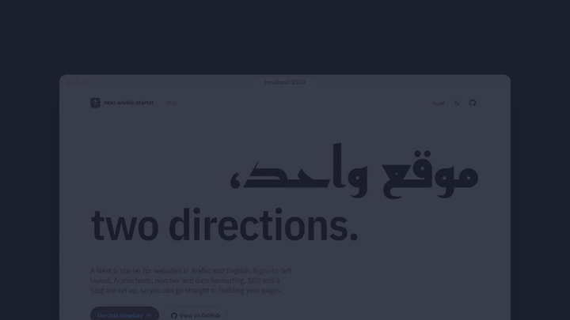
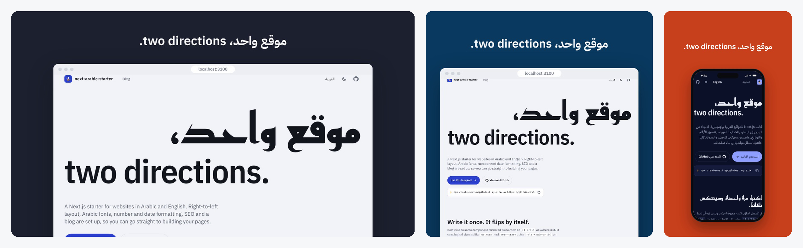

# showsite

Turn a website into a narrated promo video. A visual editor, local voice-over, and one-command exports. Free and open source.

```bash
npx showsite studio
```

<p align="center">
  
</p>

showsite opens the page in a headless browser, finds its sections, and films them like a camera would: a slow push-in on the hero, smooth scrolls between sections, captions taken from your headings. The result is an MP4 you can post as is.

- **A visual editor.** Scan a website, edit and reorder scenes, customize the design, listen to a voice sample, and export an MP4 from your browser. Runs on localhost.
- **Free local voice-over.** Read captions or a separate script aloud. Each scene extends to fit its spoken line. No API key, account, or paid speech service.
- **Three shapes.** 16:9 for YouTube and X, 1:1 for feeds, 9:16 for Reels, TikTok and Shorts.
- **Device frames.** A browser window, or a phone that shows your site's real mobile layout.
- **Captions that read well.** Pulled from your headings or written by you. Arabic, mixed Arabic and English, and right-to-left pages work properly.
- **Smooth every time.** Frames are captured one by one on a virtual clock, so the scroll never stutters and the same settings give the same video.
- **Clean shots.** Cookie banners and chat bubbles are hidden. Lazy images are loaded before the camera gets there. Scroll animations play on camera.
- **Music made for your video.** showsite composes a soundtrack for every video, timed to the edit: the beat drops at the first cut, scene changes land on the beat, each camera move gets a whoosh, and it ends on a final hit. The soundtrack is synthesized by Showsite without sampled recordings. Or use your own track.
- **Works on localhost.** Record your dev server before you deploy.

<p align="center">
  
</p>

## Quick start

You need Node.js 22.12 or newer. ffmpeg comes with showsite, and so does the browser (it downloads once, the first time you run it).

```bash
# A 16:9 video in a browser frame
npx showsite https://your-site.com

# A vertical video on a phone, for Reels and TikTok
npx showsite https://your-site.com -f 9:16

# Softer music
npx showsite https://your-site.com --music calm

# Your dev server, in dark mode, with your own track, cut to its length
npx showsite localhost:3000 --theme dark -a track.mp3 --fit-audio
```

The video is saved next to you as `your-site.com-16x9.mp4`.

## Open the dashboard

```bash
showsite studio
# Or start with a website already entered
showsite studio https://your-site.com
```

The dashboard opens at **http://127.0.0.1:4310**. Leave the terminal running while you use it. Press Ctrl+C to stop. Use `--port 4311` if the port is occupied, or `--no-open` to print the address without opening a browser.

1. Paste a URL and click **Find scenes**, or choose **Try a demo**.
2. Click a storyboard card to edit its caption, narration script, camera movement, and minimum duration. Use Earlier/Later to reorder, or add another detected section.
3. Choose the format, frame, backdrop, and caption style in **Design**.
4. In **Voice**, choose a narrator, listen to a sample, and optionally add quiet music.
5. **Preview motion** renders a 12 fps draft. **Export video** uses your selected frame rate. Play the result and download the MP4.

Exports are saved to `showsite-output/` in the folder where you started Studio. **Save project** writes an editable `.showsite.json` file to that folder and provides a download link; **Open project** loads it again. Your latest project is also saved in this browser. After reopening, scan the same URL to refresh thumbnails while keeping your scene edits.

Studio is a local desktop tool, not a hosted recording service. It listens only on the loopback interface. Page scanning and rendering still need access to the target website. Custom audio files and browser executable paths are supported through the CLI.

## Narrate the captions

```bash
showsite https://your-site.com --narration
showsite https://your-site.com/ar --narration --lang ar -f 9:16
showsite voices
showsite https://your-site.com --voice Samantha --speech-rate 165
# Optional music is automatically lowered under the voice-over
showsite https://your-site.com --narration --music calm
```

Narration uses **installed local voices**: macOS `say`, Windows `System.Speech`, or [eSpeak NG](https://github.com/espeak-ng/espeak-ng) on Linux. No caption text is sent to a hosted speech service. Voice quality and supported languages depend on the installed voices; this does not include a paid neural-voice service.

- **macOS:** English and Arabic voices are used when available. Add voices in System Settings → Accessibility → Read & Speak (or Spoken Content, depending on macOS).
- **Windows:** install the speech voices for your language in Windows settings. `showsite voices` lists voices available to the desktop speech engine; some OneCore-only voices may not appear.
- **Linux:** install eSpeak NG (`sudo apt install espeak-ng` on Ubuntu/Debian). Available languages depend on the installed build. Its voices are functional but less natural than premium neural voices.

Use `showsite voices` to find the exact voice names on your computer. If no matching voice exists, Showsite explains what to install instead of quietly using the wrong language. `--lang` also sets the website's browser locale; it does not translate your captions. With no explicit language or voice, Arabic is detected per line, otherwise English is used. A mixed-language line is spoken by a single voice.

To say something different from the on-screen caption, set `narration` on a scene:

```json
{
  "url": "https://your-site.com",
  "narration": { "enabled": true, "rate": 175 },
  "scenes": [
    { "section": 1, "caption": "Meet your next workspace", "narration": "A calmer place to bring your best ideas to life." },
    { "section": 2, "caption": "Take a closer look", "narration": "" }
  ]
}
```

An omitted scene script reads the caption. An empty script makes that scene silent. Narration still works when visual captions are disabled. Each line starts after the camera begins settling, and the scene holds until speech finishes. Voice-only is the default when narration is enabled; set `music` explicitly to add a quiet background. Your own `audio` and generated narration are separate modes.

## Pick the scenes yourself

When the automatic cut is close but not quite right, write a config file and edit it:

```bash
npx showsite init https://your-site.com
```

This scans the page and writes `showsite.json` with the scenes it would pick, plus a list of every section it found:

```json
{
  "$schema": "https://unpkg.com/showsite/schema.json",
  "url": "https://your-site.com/",
  "format": "16:9",
  "scenes": [
    { "section": 1, "caption": "Ship your site in a weekend", "camera": "zoom", "duration": 3.4 },
    { "section": 3, "caption": "Everything set up for you" },
    { "section": "#pricing", "caption": "Free and open source", "camera": "hold" }
  ],
  "availableSections": ["1. Ship your site in a weekend", "2. Logos", "3. Features", "4. Pricing", "5. Footer (footer)"]
}
```

Change the captions, reorder the scenes, drop the ones you don't want, then run `npx showsite` in the same folder. Your editor will autocomplete every field thanks to the `$schema` line.

A scene's `section` is either a number from `availableSections` or any CSS selector. Its `camera` is one of:

| camera | what it does |
| --- | --- |
| `zoom` | a slow push-in. The default for the first scene. |
| `scroll` | drifts down through the section. The default for the others. |
| `hold` | stays still. Good for a pricing table or a final call to action. |

Set `"caption": ""` to show a scene without text.

## Arabic and right-to-left sites

Record the Arabic version of a site that picks its language from the browser:

```bash
npx showsite https://your-site.com --lang ar -f 9:16
```

Or point at the Arabic URL directly (`https://your-site.com/ar`). Captions in Arabic, or mixed with English, are shaped and ordered correctly, using IBM Plex Sans Arabic.

## Options

Every option works on the command line and in `showsite.json`.

| Command line | showsite.json | Default | |
| --- | --- | --- | --- |
| `-f, --format` | `format` | `16:9` | `16:9`, `1:1` or `9:16` |
| `--frame` | `frame` | `browser` (`phone` for 9:16) | `browser`, `phone` or `none` |
| `-b, --background` | `background` | `ink` | `ink`, `coral`, `mist`, `white`, `black`, `forest`, `ocean`, or any CSS color or gradient |
| `--theme` | `theme` | `light` | record the site's `light` or `dark` mode |
| `--lang` | `language` | | browser language, e.g. `ar` |
| `-m, --music` | `music` | `upbeat` | `upbeat`, `calm` or `none` (`--no-music` works too) |
| `--narration` / `--no-narration` | `narration.enabled` | `false` | generate local speech from each scene |
| `--voice` | `narration.voice` | automatic | installed voice name; enables narration |
| `--speech-rate` | `narration.rate` | `175` | 80 to 300 words per minute |
| `--no-sfx` | `sfx` | `true` | whooshes on camera moves |
| `-a, --audio` | `audio` | | your own mp3, m4a or wav, used instead of the composed music |
| `--fit-audio` | `fitToAudio` | `false` | make the video exactly as long as the audio |
| `--no-captions` | `captions.enabled` | `true` | |
| `--animation` | `captions.animation` | `words` | `words`, `fade` or `none` |
| `--hide` | `hide` | | extra CSS selectors to hide, e.g. `--hide .promo-bar "#newsletter"` |
| `--max-scenes` | `maxScenes` | `6` | how many sections to show when picking automatically |
| `--fps` | `fps` | `30` | 12 to 60 |
| `--address-bar` | `addressBar` | the site's host | text in the browser frame, e.g. your real domain while recording localhost |
| `-o, --out` | `out` | `<site>-<format>.mp4` | |
| `--chrome` | `chromePath` | | use a specific Chrome or Chromium |
| `-q, --quiet` | | | only print errors |

Commands:

```bash
showsite studio [url] [options]  # open the local visual editor
showsite voices                   # list local narration voices
showsite <url> [options]          # record a site
showsite                          # record using ./showsite.json
showsite render [file] [options]  # record using a config file; options override it
showsite init <url> [options]     # write an editable showsite.json
```

## Use it from code

```ts
import { render, resolveConfig } from "showsite";

const result = await render(
  resolveConfig({
    url: "https://your-site.com",
    format: "9:16",
    scenes: [{ section: 1, caption: "Hello" }, { section: "#pricing" }],
  }),
);

console.log(result.file, result.duration);
```

## How it works

1. **Open.** The site loads in an iframe inside a small compositor page, at its own viewport size (1280 wide for desktop, 390 × 844 on a phone). Headers that forbid framing are removed for that request only, and frame-busting scripts can't reach the top page.
2. **Warm up.** showsite scrolls through the page once so lazy images and fonts load, then reloads it so scroll animations play again on camera.
3. **Scan.** It finds the page's sections and headings, a sticky header if there is one, and picks the scenes.
4. **Plan.** Each scene gets a camera path: where to start, where to drift to, how long to travel there, with eased motion and a soft fade at both ends.
5. **Film.** For every frame, it sets the scroll position, moves the page's CSS animations, transitions and videos to that frame's time, waits for images in view, then takes a screenshot. The compositor draws the caption, frame and background around it.
6. **Score.** The music is written for this exact edit: scene lengths are snapped to the beat, the drums come in at the first cut, and a final chord lands about a second before the end. It's synthesized on the spot (pads, bass, drums, a mallet arpeggio, reverb) and mastered to about -14 LUFS, the level social platforms play at.
7. **Encode.** Frames are streamed straight into ffmpeg (H.264, yuv420p, `+faststart`) along with the soundtrack.

## Good to know

- **MP4 videos on the page need Google Chrome or Microsoft Edge.** Playwright's own Chromium can't play H.264, so a site's background video would show up empty. showsite uses Chrome or Edge when one is installed, and tells you when a video couldn't play.
- **Animations driven by JavaScript** (requestAnimationFrame, GSAP tickers, canvas, WebGL) run on the real clock, not the virtual one. They'll look fine, just not identical between renders. CSS animations, transitions and videos are frame-exact.
- **Pages behind a login, or behind bot protection** that blocks headless browsers, can't be recorded yet.
- A 20-second 1080p video takes about 30 to 60 seconds to make on a laptop.

## Roadmap

- More natural optional local neural voices
- Drag-and-drop scene rearranging and richer timeline editing
- Cursor and click highlights
- More frames (tablet, laptop) and caption styles
- GIF and WebM output

Ideas and bug reports are welcome in [issues](https://github.com/mahmoudaladin7/showsite/issues).

## Develop

Use a current Node.js 22, 24, or 26 release for development (the build tools require Node.js 22.18+ or 24.11+).

```bash
git clone https://github.com/mahmoudaladin7/showsite.git
cd showsite
npm install
npm run build
npm test
npm link
showsite studio

# record the test site
node test/fixtures/server.mjs &
node dist/cli.js localhost:4321
```

## License

MIT © [Mahmoud Aladin](https://mahmoudaladin.netlify.app). Captions use [IBM Plex Sans](https://github.com/IBM/plex), licensed under the SIL Open Font License 1.1.
